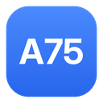
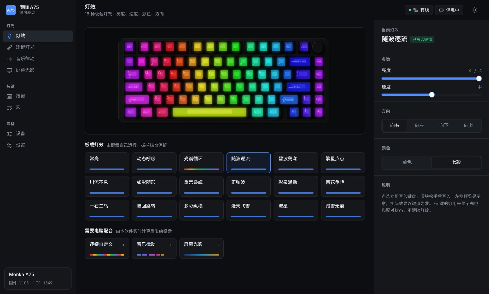
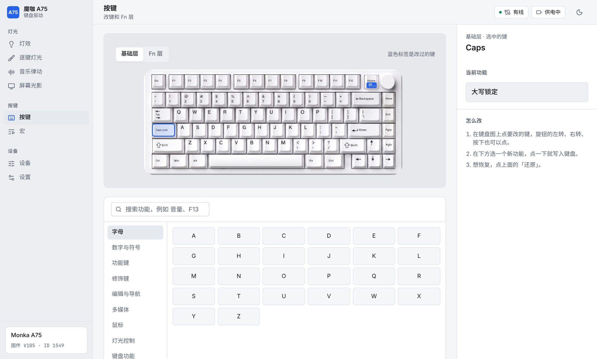

  

<h1 align="center">A75 Driver</h1>

  魔咖 Monka A75 三模机械键盘的第三方驱动，中文界面，Windows。 
  An unofficial driver for the Monka A75 keyboard. <a href="#english">English below.</a>

  
  
  

原版驱动能做的它都能做，界面更清楚。另外加了一些原版没有的功能，放在「实验性功能」开关后面。

**不会刷固件。** 本软件只发送原版驱动也会发的设置命令，所有改动都能用原版驱动的「恢复默认」清除。

## 功能

| 功能 | 说明 |
|---|---|
| 灯效 | 18 种板载灯效，亮度、速度、颜色、方向；左侧动画预览，按键触发类灯效会跟着你敲键盘反应 |
| 逐键灯光 | 给每个键单独上色，存进键盘 |
| 音乐律动 | 律动 2、律动 3，竖立、分离、交叉三种样式 |
| 屏幕光影 | 键盘跟随屏幕主色变化 |
| 按键 | 改键，组合键，多媒体键，鼠标键（Fn 层改键还在排查，暂时不生效） |
| 宏 | 录制按键，三种触发方式：按一下执行、按一下开/关、按住循环 |
| 设备 | 防抖、无线休眠、Win 键锁、WASD 互换、配置档、恢复出厂 |
| 设置 | 中文 / English，深色 / 浅色，托盘，开机启动，检查更新 |

### 实验性功能

在「设置」里打开后出现。都还在测试中。

| 功能 | 说明 |
|---|---|
| 键盘仪表 | 把键盘当小屏幕显示 CPU、内存、音量、倒计时 |
| 旋钮 | 一键把旋钮设成音量、切歌、亮度、滚轮等 |
| 按程序切换 | 打开指定程序时自动换灯效、锁 Win 键 |
| 打字统计 | 按键热力图，只计次数，不记录内容，不上传 |
| 回报率 | 125 / 250 / 500 / 1000 Hz（固件是否照做尚未确认） |
| 备份与恢复 | 改键、灯效、防抖、休眠存成一个文件 |
| 文字转宏 | 输入一段英文，生成会自动打字的宏 |

## 连接方式

| 连接 | 能做什么 |
|---|---|
| 数据线 | 全部功能 |
| 2.4G 接收器 | 正在适配，还不能用；以后音乐律动、屏幕光影、恢复出厂仍需插线 |
| 蓝牙 | 不能设置。键盘在蓝牙下不开放设置通道，原版驱动也一样 |

本软件和原版驱动不能同时打开。用之前先完全退出原版驱动，包括右下角托盘图标。

## 安装

到 [Releases](https://github.com/EvanRPG/Monka-A75-rebuild-/releases/latest) 下载 `A75 Driver_*_x64-setup.exe`，双击安装。需要 Windows 10 或 11。

想自己构建：安装 [Node.js](https://nodejs.org/) 和 [Rust](https://rustup.rs/)，下载本仓库，双击 `build-windows.bat`。

## 出问题怎么办

- 软件显示「键盘停止响应了」：拔掉数据线，等 10 秒再插回去。
- 灯不亮或不听使唤：退出本软件，打开原版驱动，点「恢复默认」。
- 找不到键盘：页面上点「生成诊断信息」，把结果贴到 [Issues](https://github.com/EvanRPG/Monka-A75-rebuild-/issues)。只读取，不写入键盘。

## 致谢与许可

本项目基于 [sharkfin](https://github.com/dniminenn/sharkfin)（JR Lanteigne，GPL-3.0-or-later）。与键盘通信的后端来自 sharkfin，在此基础上加了 A75 专用的功能，界面全部重写。协议说明见 [docs/PROTOCOL.md](docs/PROTOCOL.md)。

开发中得到了两个 AI 助手的帮助：

- **Meta Muse**：早期的协议分析和原版驱动研究。
- **Anthropic Claude**：后端扩展、界面、灯效预览和测试流程的编写。

本项目同样以 [GPL-3.0-or-later](LICENSE) 发布。

本软件不是魔咖官方驱动，与厂商无关。「魔咖」「Monka」是其所有者的商标，这里只用来说明适用的键盘。

作者：EvanRPG

---

## English

An unofficial driver for the **Monka A75** tri-mode keyboard (firmware ID 1549, USB `3151:4015`, 2.4G receiver `3151:4011`). Chinese and English interface. Windows.

It never flashes firmware. It sends only the settings commands the original driver sends, and every change can be cleared with Restore defaults in the original driver.

**Features:** 18 onboard effects with a live preview, per-key colour, music sync (two modes, three styles), screen sync, key remapping (Fn layer remaps are still being investigated), macros, debounce, wireless sleep, profiles, factory reset.

**Experimental** (turn on in Settings): keyboard meters (CPU, memory, volume, countdown), knob presets, per-app lighting, typing heatmap, report rate, backup and restore, text to macro.

**Connection:** use the cable. 2.4G receiver support is still being worked on. Bluetooth has no settings channel.

**Install:** download `A75 Driver_*_x64-setup.exe` from [Releases](https://github.com/EvanRPG/Monka-A75-rebuild-/releases/latest). Windows 10 or 11. To build it yourself, install Node.js and Rust and run `build-windows.bat`.

Built on [sharkfin](https://github.com/dniminenn/sharkfin) by JR Lanteigne. Thanks to Meta Muse (early protocol research and vendor driver analysis) and Anthropic Claude (backend extensions, interface, effect previews, test process). Licensed [GPL-3.0-or-later](LICENSE). Not affiliated with Monka; the name is used only to say which keyboard this is for.
